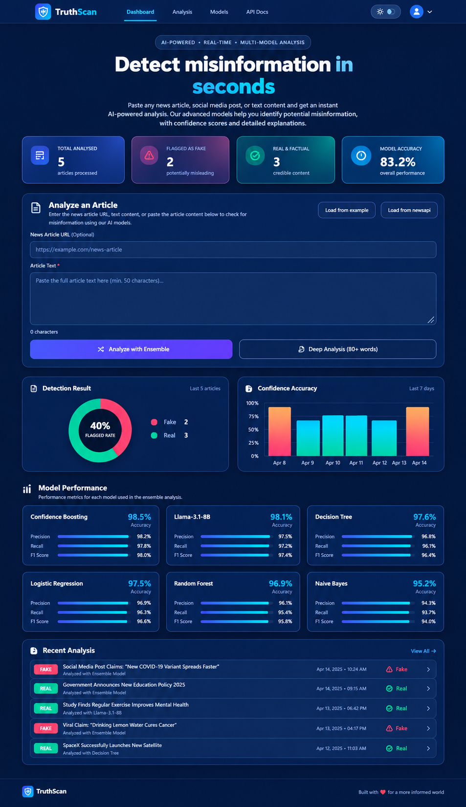

# Fake News Detector


## Dashboard Preview


An ultra-fast Fake News Detection API leveraging a calibrated Machine Learning ensemble and spaCy NLP preprocessing. The honest grouped in-domain result is approximately 96–97%; the original 98.44% result was from a random split and is not comparable. The reported DistilBERT 99.97% result is not reproducible from this repository.

### What this measures

The 96–97% score measures performance on this dataset's source, time, topic, and writing-style mixture after duplicate groups are separated. It does not measure fact-checking ability, publisher-held-out generalization, time-held-out generalization, or real-world accuracy. Phase B found measurable publisher/format and topic shortcuts, so external performance must be evaluated separately.

---

## Features

| Feature | Description |
|---------|-------------|
| **5 ML Model Ensemble** | Combines Logistic Regression, Decision Tree, Gradient Boosting, Naive Bayes, and Linear SVC for average calibrated probability-based prediction. |
| **spaCy NLP Pipeline** | Fast, production-ready natural language processing (`en_core_web_sm`). |
| **Rate Limiting** | Protected with SlowAPI — 10 requests/minute per IP on analysis endpoint. |
| **Input Validation** | Strict length and whitespace sanitization using Pydantic V2 validators. |
| **Structured Logging** | Clean, asynchronous, and rotating logs using Loguru. |
| **CI/CD** | Automated testing via GitHub Actions. |
| **Docker Support** | Fully containerized for easy scaling and deployment. |
| **REST API** | 5 specialized endpoints for health checks, model metadata, metrics, and text analysis. |
| **Live deployment on Render** | Fully hosted and accessible online. |
| **DistilBERT Deep Analysis** | Optional external model; the reported 99.97% accuracy is not reproducible from this repository. |

---

## Tech Stack

- **Backend Framework**: FastAPI (with Uvicorn & Gunicorn)
- **Machine Learning**: scikit-learn
- **NLP Preprocessing**: spaCy (`en_core_web_sm`)
- **Data Handling**: pandas, numpy
- **Rate Limiting**: slowapi
- **Validation**: Pydantic Settings
- **Testing**: pytest, httpx
- **Logging**: Loguru
- **Transformer Model**: HuggingFace DistilBERT (fine-tuned)
- **Model Hub**: Hugging Face — GuptaAshutosh/truthscan-fake-news-distilbert

---

## Project Structure

```text
.
├── .github/
│   └── workflows/
│       └── ci.yml
├── data/
│   ├── Fake.csv
│   └── True.csv
├── frontend/
│   ├── app.js
│   ├── index.html
│   └── style.css
├── models/
│   └── calibrated/
│       ├── dt_calibrated.pkl
│       ├── gbc_calibrated.pkl
│       ├── lr_calibrated.pkl
│       ├── nb_calibrated.pkl
│       ├── svc_calibrated.pkl
│       └── vectorizer.pkl
├── routers/
│   └── api.py
├── tests/
│   ├── __init__.py
│   ├── test_api.py
│   └── test_nasa.py
├── .dockerignore
├── .env
├── .gitignore
├── app.py
├── config.py
├── distilbert_predictor.py
├── Dockerfile
├── download_data.py
├── download_models.py
├── predictor.py
├── preprocessor.py
├── README.md
├── render.yaml
├── requirements.txt
├── train_production.py
└── legacy/train_legacy.py
```

---

## Local Setup

**1. Clone repo**
```bash
git clone https://github.com/ashutosh8950/fake-news-detector.git
cd fake-news-detector
```

**2. Install dependencies**
```bash
pip install -r requirements.txt
```

**3. Download spaCy model**
```bash
python -m spacy download en_core_web_sm
```

**4. Prepare the calibrated production artifacts**

Download the model artifacts required by the application:

```bash
python download_models.py
```

This downloads the five calibrated classifiers, TF-IDF vectorizer, and trusted `artifact_manifest.json` into `models/calibrated/`, along with `evaluation_results/phase2_calibration_report.json`.

To regenerate these artifacts locally instead, provide the expected dataset files `data/Fake.csv` and `data/True.csv`, then run:

```bash
python train_production.py
```

The canonical command consumes the duplicate-aware split manifest, fits TF-IDF on training rows only, calibrates the five production models, writes predictions and metrics, and generates the trusted manifest. The old six-model workflow is retained only as `legacy/train_legacy.py` and is not a production rebuild.

**5. Run the server**

```bash
python app.py
```

The application can start without model artifacts so that `/health`, `/docs`, and the frontend remain available for diagnosis. In that state `/health` returns HTTP 503 with `status: "not_ready"` and `models_loaded: false`, while `/analyze` returns HTTP 503 with `Inference unavailable: trusted model artifacts are not ready.` and never fabricates a prediction. The frontend displays `API available · models unavailable`. Inference becomes ready only after the artifact bundle passes the repository's verification checks; this does not authorize use of untrusted or historically unauthenticated artifacts.

DistilBERT deep analysis is optional. The base requirements do not install Transformers or PyTorch. Even if these dependencies are installed separately, deep analysis is available only if the DistilBERT model loads successfully; otherwise, `/analyze/deep` returns HTTP 503. The standard five-model ensemble does not require DistilBERT.

---

## Docker Instructions

**1. Build image**
```bash
docker build -t fake-news-detector .
```

**2. Run container**
```bash
docker run -p 8000:8000 fake-news-detector
```

---

## Run Tests

Run the full pytest suite (no server needed):
```bash
python -m pytest -v tests/
```

The repository CI job runs the synthetic application/readiness and contract suites without downloading datasets, model artifacts, or the spaCy language model. The model-dependent held-out test requires separately provisioned, trusted artifacts and is not part of the no-artifact CI job.

---

## API Endpoints

### 1. Health Check
`GET /health`

**Response Example**
```json
{
  "status": "ok",
  "models_loaded": true,
  "uptime_seconds": 45.2
}
```

### 2. Models Info
`GET /models/info`

**Response Example**
```json
{
  "gbc": {
    "name": "Gradient Boosting",
    "accuracy": 98.5,
    "precision": 98.52,
    "recall": 98.5,
    "f1": 98.51
  },
  "lr": {
    "name": "Logistic Regression",
    "accuracy": 97.53,
    "precision": 97.53,
    "recall": 97.53,
    "f1": 97.53
  }
}
```

### 3. Analyze News
`POST /analyze`

**Request Example**
```json
{
  "title": "Local Man Discovers Infinite Energy",
  "text": "A local scientist has completely defied the laws of thermodynamics in his garage..."
}
```

**Response Example**
```json
{
  "predictions": {
    "Logistic Regression": "Fake",
    "Decision Tree": "Fake",
    "Gradient Boosting": "Fake",
    "Naive Bayes": "Fake",
    "Linear SVC": "Fake"
  },
  "ensemble_label": "Fake",
  "overall_confidence": 100.0,
  "processing_time_ms": 12.4
}
```

### 4. Deep Analyze (DistilBERT)
`POST /analyze/deep`
Rate limit: 5 requests/minute

**Request Example**
```json
{
  "title": "Local Man Discovers Infinite Energy",
  "text": "A local scientist has completely defied the laws of thermodynamics..."
}
```

**Response Example**
```json
{
  "label": "FAKE",
  "confidence": 97.9,
  "processing_time_ms": 245.3
}
```

### 5. Metrics
`GET /metrics`

Returns API usage statistics and health metrics. Note: These metrics are process-local and will reset upon application restart.

**Response Example**
```json
{
  "total_requests": 150,
  "fake_detected": 85,
  "real_detected": 65,
  "avg_confidence": 94.5,
  "uptime_seconds": 3600.5,
  "models_loaded": true,
  "api_version": "2.0.0"
}
```

---

## Model Accuracy

The primary grouped evaluation reports 96.39% accuracy on 3,653 held-out articles, with ROC-AUC 96.47%, Brier score 0.03490, and ECE 0.01330. This split keeps duplicate-aware groups together and is the headline release metric.

The original random split reported 98.44% accuracy and Brier score 0.013835. It used the same 20,700/3,653 row counts but a random stratified split; the grouped protocol is more conservative because it prevents related article groups from crossing the evaluation boundary. These are different protocols and should not be compared as a controlled model change.

| Model | Accuracy | Precision | Recall | F1 Score |
|-------|----------|-----------|--------|----------|
| **Gradient Boosting** | 98.50% | 98.52% | 98.50% | 98.51% |
| **Linear SVC** | 98.06% | 98.06% | 98.06% | 98.06% |
| **Decision Tree** | 97.60% | 97.60% | 97.60% | 97.60% |
| **Logistic Regression**| 97.53% | 97.53% | 97.53% | 97.53% |
| **Naive Bayes** | 95.17% | 95.18% | 95.17% | 95.17% |

---

## AI Models

## Known Limitations

Classifier accuracy is measured on the training distribution's dominant topics; performance on underrepresented topics (e.g., science/space news) has not been separately validated and may be less reliable.

The dataset contains strong source-style signals, including Reuters-like bylines and outlet wording. The model may learn source style rather than fact validity. TruthScan is not a fact-checker, and no out-of-domain evaluation has been completed.

The production ensemble uses five models. Random Forest was removed because its calibrated artifact caused memory issues on constrained deployment environments; the five-model ensemble performs equal or better on the held-out evaluation.

- TruthScan estimates whether an article resembles patterns learned from its dataset; it does not verify claims against live external sources, and confidence is calibrated probability on the evaluation distribution, not factual certainty.

| Model | Type | Accuracy | Hosted |
|---|---|---|---|
| Ensemble (5 models) | TF-IDF + scikit-learn | 96.39% grouped / 98.44% original random split | Local |
| DistilBERT | Fine-tuned Transformer | 99.97% reported, not reproducible here | Hugging Face |

*The DistilBERT figure is externally reported and is not reproducible from this repository; its training script and evaluation artifacts are absent.*

Hugging Face Model: https://huggingface.co/GuptaAshutosh/truthscan-fake-news-distilbert

---

## Live Demo

Test the application live: [https://truthscan-fake-news-detector.onrender.com](https://truthscan-fake-news-detector.onrender.com)
