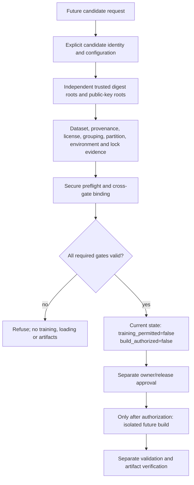

# Candidate Build Workflow

The proposed workflow is a refusal-first boundary. No real build is authorized by this document.

## Required evidence

The future candidate path must bind the candidate release ID to exact dataset byte digests, provenance/licensing evidence, the approved grouping fingerprint, partition manifest and certificate hashes, dependency-lock/environment records, and an authenticated approval. Trust roots must be provisioned independently of the evidence being verified. Missing, malformed, unsigned, stale, mismatched, or owner-unapproved evidence must refuse.

## Current status

The repository has candidate-only preflight/harness work and synthetic tests, but no real candidate bundle or production trust root. The Task 33–34 orchestration work is architectural/candidate-only and does not override unresolved real-world gates. A synthetic all-gates-passing fixture must still terminate without invoking training.

## Explicit non-claims

This workflow does not authenticate the historical bundle, establish dataset rights, create a lockfile, authorize training, create artifacts, or approve deployment.
