# TruthScan Architecture

## Scope and evidence status

This diagram reflects the inspected application source. It distinguishes directly inspected code from the isolated Track B prototype. It does not certify the historical model bundle, dataset rights, or production release readiness.

```mermaid
flowchart LR
    Browser[Frontend: frontend/index.html and app.js]
    App[FastAPI app.py]
    Router[routers/api.py]
    Input[AnalyzeRequest validation]
    Prep[preprocessor.py\nspaCy cleaning and lemmatization]
    Pred[predictor.py\nFakeNewsPredictor]
    Distil[distilbert_predictor.py\noptional deep path]
    Contract[artifact_contract.py\nmanifest/readiness verification]
    Bundle[(models/calibrated/\nvectorizer + calibrated models)]
    Output[Fake/Real predictions\nprobabilities and confidence]
    TrackB[Track B isolated synthetic prototype\ntask44_synthetic_prototype]
    TrackBUI[Static UI_MOCKUP.html\nsynthetic-only, disabled]

    Browser -->|HTTP /analyze and /analyze/deep| App
    App --> Router
    Router --> Input
    Input --> Prep
    Prep --> Pred
    Pred --> Contract
    Contract -->|verify before load| Bundle
    Pred --> Output
    Input --> Distil
    Distil --> Output
    Output --> Browser

    TrackB -. not imported or routed .-> TrackBUI
    TrackBUI -. isolated from production .-> Browser
```

## Observed production boundaries

- `app.py` creates the FastAPI app, includes `routers.api`, mounts `frontend/` at `/static`, and serves `frontend/index.html` at `/`.
- `routers/api.py` defines `/health`, `/models/info`, `/metrics`, `/analyze`, and `/analyze/deep`. The article request validates text length and calls the production predictors.
- `preprocessor.py` loads `en_core_web_sm` and transforms title/body text.
- `predictor.py` points at `models/calibrated/`, calls artifact verification, then deserializes the vectorizer and five calibrated model files. It emits per-model labels and an ensemble label/probability.
- `distilbert_predictor.py` is used by the deep-analysis route; its external model claims are not treated as independently reproduced evidence here.
- `frontend/app.js` calls the production API endpoints and renders Fake/Real results. It is not a fact-checking evidence UI.

## Track B boundary

`synthetic_claim_api.py` imports only standard-library validation/escaping helpers. `UI_MOCKUP.html` is static and disabled, and the prototype is not imported by `app.py`, `routers/api.py`, or the frontend. Its outcomes are synthetic contract demonstrations, not factual conclusions.
